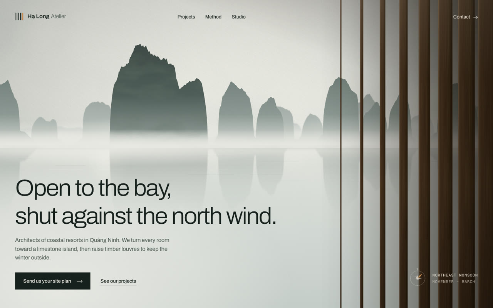
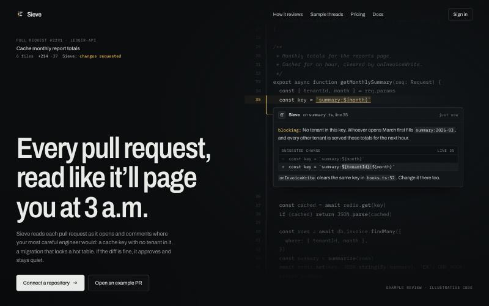
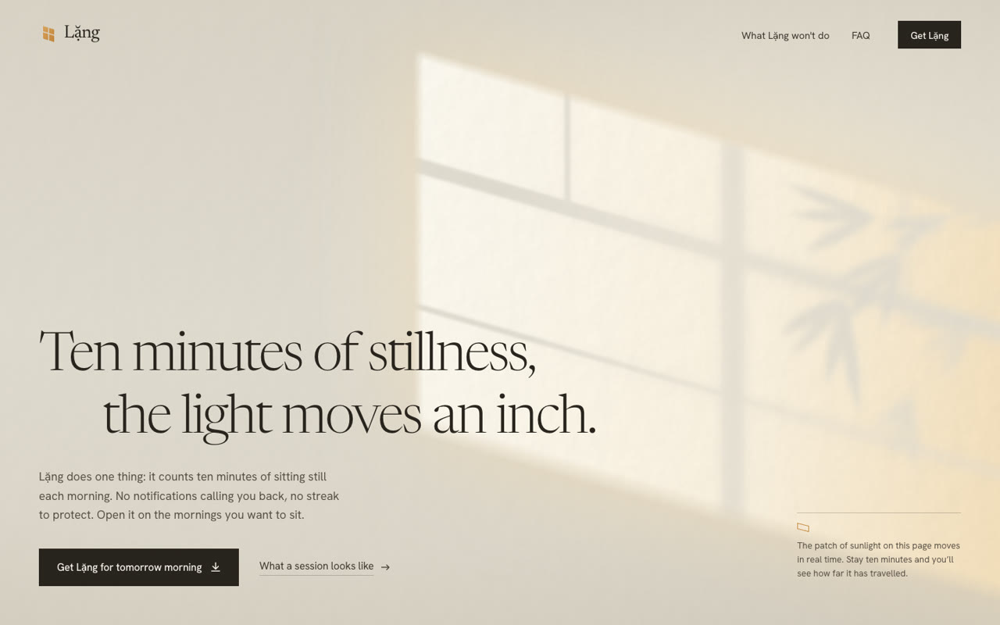
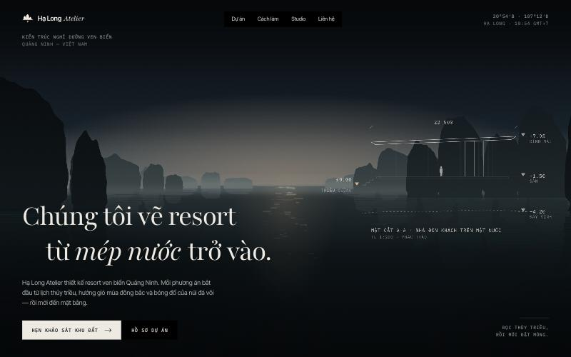
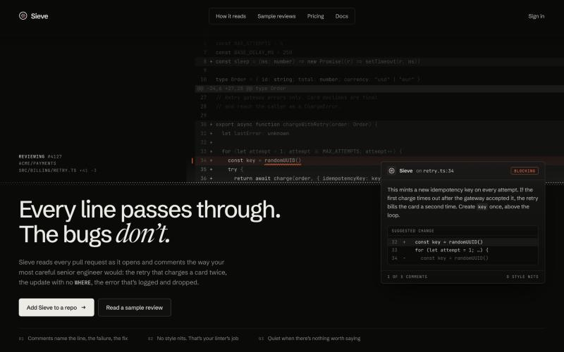
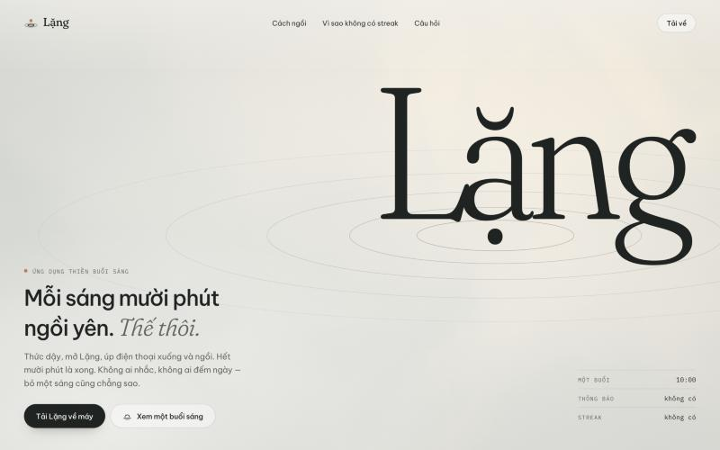
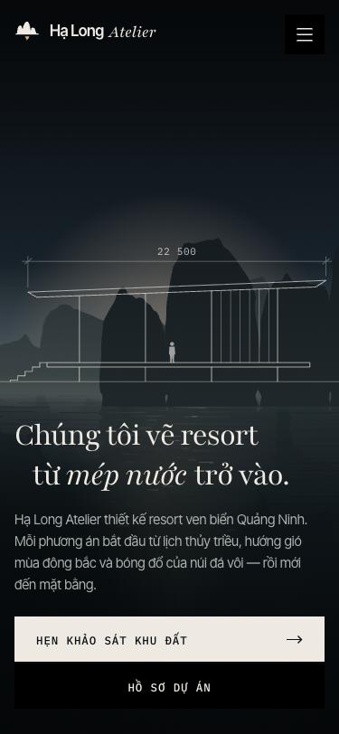
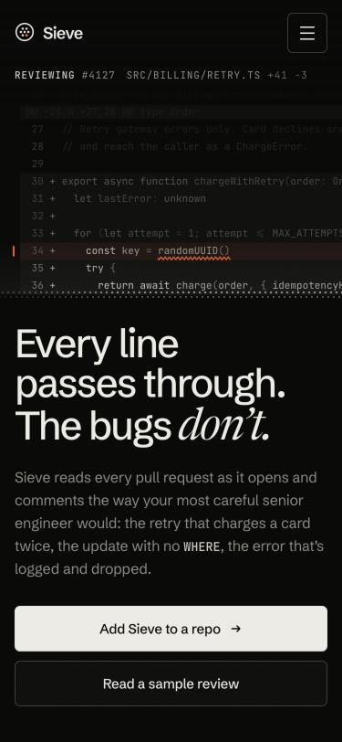
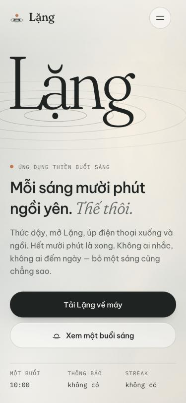
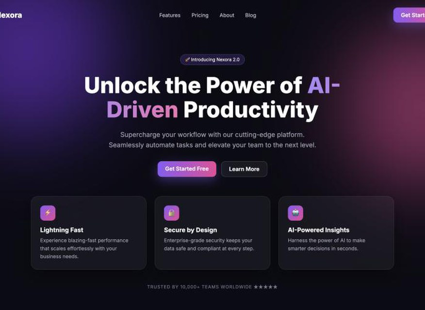

# Cinematic Motion UI

**Skill cho Claude để dựng hero / landing page có chuyển động, đẹp kiểu điện ảnh như các mẫu trên [motionsites.ai](https://motionsites.ai), và không bị nhận ra là AI làm.**

*A Claude skill for building cinematic, motion-rich hero sections and landing pages that don't read as AI-generated.*



---

## Sản phẩm trình bày

Ba trang dưới đây do Claude làm theo skill, mỗi trang từ **một câu yêu cầu ngắn**. Các trang không dùng ảnh hay video có sẵn: phong cảnh, ánh sáng và chuyển động đều do code vẽ ra. Mở file trong `examples/` bằng trình duyệt để xem chuyển động.

### Hạ Long Atelier: studio kiến trúc resort ven biển

> "Làm giúp mình hero section cho Hạ Long Atelier, studio kiến trúc chuyên thiết kế resort ven biển ở Quảng Ninh. Muốn cảm giác sang, điện ảnh, chuyển động mượt, đừng giống mấy trang AI làm sẵn."


Khi trang mở ra, vách lá chớp gỗ xoay dần từng thanh để lộ vịnh đá vôi trong sương sớm. Vài thanh cuối vẫn khép hờ, đúng với tiêu đề *"Mở phòng ra vịnh, khép lại trước gió bấc."*
→ [`examples/cinematic-bay-hero.html`](examples/cinematic-bay-hero.html)

### Sieve: công cụ AI review code

> "Build a landing hero for Sieve, an AI code-review tool… Dark and technical, but NOT the generic purple-gradient AI look."



Hình chính là chính sản phẩm: một vệt "đọc code" chạy dọc số dòng, dừng ở dòng có lỗi, rồi đoạn code tách ra để hiện lời nhận xét như của một kỹ sư lâu năm.
→ [`examples/dark-code-review-hero.html`](examples/dark-code-review-hero.html)

### Lặng: app thiền buổi sáng

> "Tạo hero cho app thiền 'Lặng': mỗi sáng 10 phút ngồi yên, không thông báo, không streak. Tông sáng, nhẹ, chuyển động tinh tế; mobile phải đẹp."



Nắng sớm chiếu qua ô cửa lên bức tường, bóng tre đung đưa. Vệt nắng trôi thật trên tường trong đúng 10 phút, bằng thời gian một buổi ngồi.
→ [`examples/light-window-hero.html`](examples/light-window-hero.html)

### Phiên bản đầu của skill (để so sánh)

Cùng 3 đề, làm bằng phiên bản skill đầu tiên. Hàng dưới là ảnh trên điện thoại.

| Hạ Long Atelier | Sieve | Lặng |
|---|---|---|
|  |  |  |
|  |  |  |

---

## Kết quả chấm mù

Ba giám khảo (các phiên Claude độc lập đóng vai art director) chấm 14 ảnh chụp trang web mà **không biết trang nào do ai làm**. Mỗi ảnh được chấm theo 2 tiêu chí: mức độ cao cấp (1–10), và khả năng người xem nhận ra ngay đây là trang do AI làm (càng thấp càng tốt).

| Nhóm | Bị nhận ra là AI | Điểm cao cấp | Hạng trung bình (/14) |
|---|---|---|---|
| **Có skill (bản hiện tại)** | **35%** | **6,9** | **4,7** |
| Có skill (bản đầu) | 46% | 6,3 | 6,8 |
| Không dùng skill | 56% | 6,1 | 7,7 |
| Mẫu thật trên MotionSites | 56% | 5,5 | 8,4 |
| Trang "kiểu AI" điển hình (đối chứng) | 97% | 1,7 | 14 |



*Trang đối chứng: gradient tím, quả cầu phát sáng, 3 thẻ tính năng có emoji. Giám khảo nhận ra nó là AI với độ chắc chắn 97%.*

**Lưu ý trung thực:** giám khảo là AI chứ không phải người thật, và mỗi nhóm chỉ có 3 trang, nên các con số chỉ mang tính tham khảo. Trang được chấm cao nhất trong lần thử là một trang **không** dùng skill. Skill giúp nâng mặt bằng chung, chứ không bảo đảm trang nào cũng thắng.

Bài học lớn nhất rút ra từ lần chấm: chính các "chiêu" quen thuộc của những thư viện mẫu (in nghiêng một chữ serif trong tiêu đề, nhãn "New" nhỏ phía trên, hàng 3 con số ở chân trang) nay đã bị dùng tràn lan và trở thành dấu hiệu "AI có gu". Skill hiện tại dạy Claude tránh chúng. Thay vào đó, mỗi trang phải có **một ý tưởng riêng** gắn với chính sản phẩm.

---

## Cài đặt

**Claude Code** (dùng cho mọi dự án):

```bash
git clone https://github.com/vhphat2206/cinematic-motion-ui.git ~/.claude/skills/cinematic-motion-ui
```

Hoặc chỉ cho một dự án: đặt thư mục vào `.claude/skills/cinematic-motion-ui` trong dự án đó.

Skill cần cả thư mục, không chỉ riêng `SKILL.md`, vì `SKILL.md` gọi tới các file trong `references/`, `assets/`, `scripts/` và `examples/`.

## Cách dùng

Nhờ Claude như bình thường, skill sẽ tự bật:

- "Làm hero cho tiệm hoa của mình ở Hà Nội, sang, có chuyển động, đừng giống AI làm"
- "Build a launch page for our dev tool, dark and cinematic, not the purple-gradient look"
- "Trang chủ studio mình nhìn rẻ quá, làm lại phần hero cho xịn"
- "Viết cho mình một prompt thật chi tiết để dán vào Lovable tạo hero kiểu motionsites"

Muốn chắc chắn skill được dùng thì gõ `/cinematic-motion-ui` ở đầu yêu cầu.

Claude sẽ làm theo 7 bước:

1. Chọn hướng đi (một trong 7 phong cách) và **một khoảnh khắc đáng nhớ**.
2. Viết bản đặc tả với giá trị cụ thể trước khi code.
3. Chọn hình ảnh hoặc video.
4. Dựng trang.
5. Viết nội dung cụ thể, không sáo rỗng.
6. Tự kiểm tra trên trình duyệt ở 3 kích thước màn hình.
7. Báo lại phần nào là tạm, cần anh/chị thay.

## Bên trong skill có gì

```
SKILL.md                 Quy trình 7 bước và các nguyên tắc chung
references/
  archetypes.md          7 phong cách bố cục (điện ảnh, tech tối, chữ khổng lồ, nhân vật 3D…)
  typography.md          Cặp font theo phong cách và bảng font Google có hỗ trợ tiếng Việt
  anti-ai-tells.md       Các dấu hiệu "trang do AI làm" và cách thay thế
  motion.md              Hệ thống chuyển động: easing, nhịp xuất hiện, cuộn, rê chuột
  materials.md           Nút kim loại, kính mờ, chrome, grain
  responsive.md          Co giãn theo màn hình, kể cả màn thấp và điện thoại
  media.md               Video, ảnh, nền tự vẽ bằng code, cách viết prompt tạo ảnh
  spec-template.md       Mẫu đặc tả, và mẫu prompt để dùng với công cụ khác
  react-port.md          Ghi chú cho React / Next.js / Tailwind / Framer Motion
assets/
  motion-kit.css/js      Bộ chuyển động dùng lại được, có cơ chế dự phòng để trang không bị trắng
  backgrounds/           3 nền động: sóng hạt, sương (WebGL), vòng cung tự vẽ
  starter.src.html       Khung trang để bắt đầu
scripts/
  audit.py               Quét code tìm dấu hiệu "AI làm" và lỗi chuyển động
  runtime_check.js       Kiểm tra trong trình duyệt: chữ bị ẩn, tràn ngang, font chưa tải…
  inline_kit.py          Gộp bộ chuyển động và nền động vào một file HTML
examples/                3 trang mẫu ở phần Sản phẩm trình bày
```

### Công cụ đi kèm

```bash
# Quét một trang tìm dấu hiệu AI và lỗi
python3 scripts/audit.py duong-dan/index.html

# Gộp bộ chuyển động và nền động vào một file duy nhất
python3 scripts/inline_kit.py trang.src.html index.html
```

`scripts/runtime_check.js`: dán vào console của trình duyệt (hoặc chạy bằng Playwright) sau khi trang tải xong, để nhận báo cáo dạng JSON.

### Font tiếng Việt

Nhiều font đẹp trên Google Fonts **không có dấu tiếng Việt**: Instrument Serif, Bodoni Moda, Gloock, Syne, Poppins, DM Sans… Skill có bảng tra font an toàn cho tiếng Việt (Be Vietnam Pro, Inter, Archivo, Newsreader, Playfair, Fraunces, IBM Plex Mono…), và `audit.py` sẽ cảnh báo khi trang tiếng Việt dùng font thiếu dấu.

---

## Nguồn cảm hứng

Skill được đúc kết từ việc khảo sát khoảng 440 mẫu hero trên [motionsites.ai](https://motionsites.ai), cùng với cách họ viết prompt đặc tả chi tiết. Skill không chứa nội dung prompt, hình ảnh hay tài sản nào của MotionSites. Mọi trang mẫu trong repo đều do Claude dựng mới, với thương hiệu và nội dung hư cấu.

**Tác giả:** HPhat ([@vhphat2206](https://github.com/vhphat2206)). Skill được xây dựng cùng Claude.

## Giấy phép

[MIT](LICENSE): bạn được tự do dùng, sửa đổi và chia sẻ lại skill, kể cả cho mục đích thương mại, miễn là giữ tên tác giả và nội dung giấy phép.
