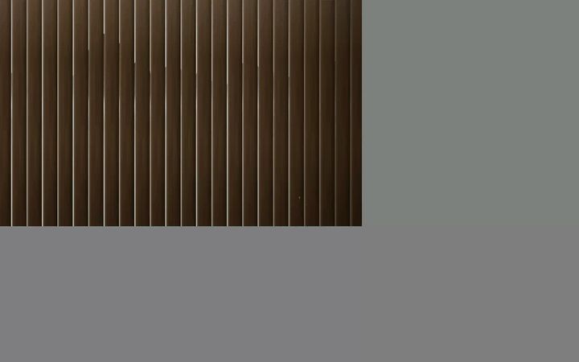
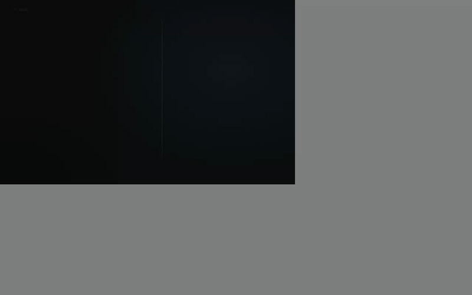
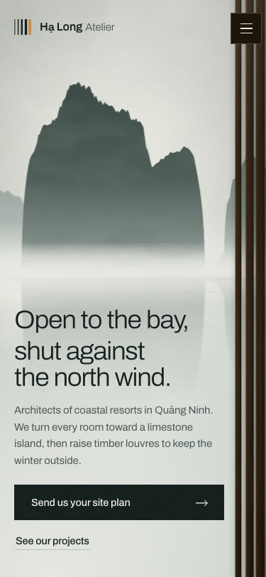
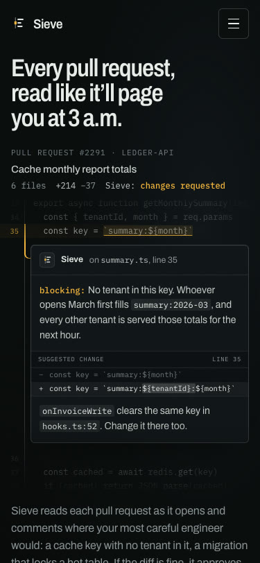
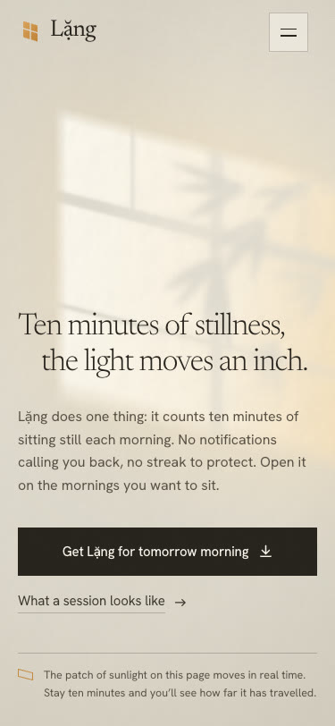

# Cinematic Motion UI

**A Claude skill for building cinematic, motion-rich hero sections and landing pages, the kind you see in premium template galleries, without the tell-tale look of AI-generated UI.**



**[▶ Live demos](https://vhphat2206.github.io/cinematic-motion-ui/)**: open the pages in your browser to see the full motion and hover effects.

---

## Showcase

Claude built each page below from **one short prompt**, with the skill loaded. No stock photos or video: every scene, light effect and animation is drawn in code. Each page is a single self-contained HTML file in [`examples/`](examples/).

### Hạ Long Atelier: coastal resort architects

> "Build a hero section for Hạ Long Atelier, an architecture studio that designs seafront resorts in Quảng Ninh. Premium, cinematic, smooth motion, and nothing like the usual AI-made templates."


On load, a wall of teak louvres turns open blade by blade to reveal a limestone bay in morning mist. The last blades stay half-closed, which makes the headline literal: *"Open to the bay, shut against the north wind."*
**[Live demo](https://vhphat2206.github.io/cinematic-motion-ui/examples/cinematic-bay-hero.html)** · [source](examples/cinematic-bay-hero.html)

### Sieve: AI code review

> "Build a landing hero for Sieve, an AI code-review tool… Dark and technical, but NOT the generic purple-gradient AI look."



The product is the image. A reading band runs down the line numbers and stops on the buggy line, then the code splits open and a review comment unfolds in the gap, written the way a senior engineer would write it.
**[Live demo](https://vhphat2206.github.io/cinematic-motion-ui/examples/dark-code-review-hero.html)** · [source](examples/dark-code-review-hero.html)

### Lặng: a morning meditation app

> "Create a hero for the meditation app 'Lặng': ten minutes of sitting still every morning, no notifications, no streaks. Light, calm, subtle motion; it has to look great on mobile."


Morning sun falls through a window onto a plaster wall while a bamboo shadow sways. The patch of light really drifts across the wall over ten minutes, the length of one sitting.
**[Live demo](https://vhphat2206.github.io/cinematic-motion-ui/examples/light-window-hero.html)** · [source](examples/light-window-hero.html)

### On mobile

| Hạ Long Atelier | Sieve | Lặng |
|---|---|---|
|  |  |  |

---

## Blind evaluation

Three independent judges (separate Claude sessions acting as Awwwards-level art directors) rated 14 hero screenshots **without knowing where any of them came from**. Each page got a score for how premium it looks (1–10), and an estimate of the chance a design-literate visitor would immediately read it as AI-generated (lower is better).

| Group | Reads as AI-made | Premium score | Avg. rank (of 14) |
|---|---|---|---|
| **With this skill (current version)** | **35%** | **6.9** | **4.7** |
| With this skill (first version) | 46% | 6.3 | 6.8 |
| Same prompts, no skill | 56% | 6.1 | 7.7 |
| Real templates from a premium gallery | 56% | 5.5 | 8.4 |
| Generic "AI SaaS" page (control) | 97% | 1.7 | 14 |


*The control page: purple glow, gradient headline, three emoji feature cards. The judges flagged it as AI-made with 97% confidence, so they can tell.*

**Caveats:** the judges are AI, not people, and each group has only three pages, so treat the numbers as indicative. The single highest-rated page in the test was made *without* the skill. The skill raises the floor; it doesn't guarantee every page wins.

**The biggest lesson** from judging: the gallery recipe itself has become a tell. A serif-italic accent word in a sans headline, a little "New" pill above it, three stats along the bottom: these are now so widely copied that reviewers read them as "tasteful AI". The current skill steers away from them and asks for **one concept that ties image, type and motion to the product** instead.

---

## Installation

**Claude Code**, available in every project:

```bash
git clone https://github.com/vhphat2206/cinematic-motion-ui.git ~/.claude/skills/cinematic-motion-ui
```

For a single project, put the folder at `.claude/skills/cinematic-motion-ui` inside that project.

The skill needs the whole folder, not just `SKILL.md`, because `SKILL.md` points to files in `references/`, `assets/`, `scripts/` and `examples/`.

## Usage

Just ask; the skill triggers on its own:

- "Build a hero for my flower shop in Hanoi: premium, animated, nothing like an AI template"
- "Make a launch page for our CLI tool: dark, cinematic, not the purple-gradient look"
- "Our studio homepage looks cheap. Redo the hero so it feels designed"
- "Write a detailed prompt I can paste into Lovable to build a gallery-style cinematic hero"

To force it, start your request with `/cinematic-motion-ui`. Prompts in English and Vietnamese both work.

Claude then follows a seven-step run:

1. **Direction:** pick one of seven archetypes and name a *signature moment*, plus the template moves to avoid.
2. **Spec before code:** tokens, layer stack, motion table and breakpoints, all as exact values.
3. **Media:** the user's assets, a generative background, or a designed media slot with a generation prompt.
4. **Build:** single-file HTML, or React / Next / Tailwind / Framer Motion.
5. **Words:** concrete copy in the product's own nouns, with no clichés and no invented proof.
6. **Verify:** static audit, in-browser checks and screenshots at 1440×900, 1280×720 and 375×812, a no-JavaScript render, then fix and look again.
7. **Report:** what is a placeholder and how to replace it.

## What's inside

```
SKILL.md                 The seven-step run and the rules that hold across archetypes
references/
  archetypes.md          Seven compositions (cinematic, dark tech, editorial mega-type, character, product, HUD, expressive)
  typography.md          Type pairings per archetype, scale rules, Vietnamese glyph coverage
  anti-ai-tells.md       First- and second-order AI tells, with replacements, plus a squint test
  motion.md              Easing tokens, entrance vocabulary, choreography, robustness rules, scroll and pointer motion
  materials.md           Liquid-metal pills, chrome and glass buttons, gradient text, grain, radius systems
  responsive.md          Token breakpoints, height breakpoints, artboard scaling, mobile menu pitfalls
  media.md               Video, photography, generative backgrounds, writing image/video generation prompts
  spec-template.md       Direction card, build spec, and a prompt form for other builders
  react-port.md          Notes for React, Next.js, Tailwind and Framer Motion
assets/
  motion-kit.css/js      Reusable entrance motion that stays visible at rest, with failsafes
  backgrounds/           Particle wave, WebGL shader field, self-drawing rings
  starter.src.html       Neutral page skeleton
scripts/
  audit.py               Static scan for AI tells and motion-robustness problems
  runtime_check.js       In-browser checks: hidden text, overflow, clipping, fonts, tap targets
  inline_kit.py          Inlines the motion kit and backgrounds into a single HTML file
examples/                The three showcase pages
```

### Tools

```bash
# Scan a page for AI tells and robustness problems
python3 scripts/audit.py path/to/index.html

# Build a single self-contained file from a source with kit placeholders
python3 scripts/inline_kit.py page.src.html index.html
```

To use `scripts/runtime_check.js`, evaluate it in the page (DevTools console or Playwright `page.evaluate`) about three seconds after load. It returns a JSON report.

### Vietnamese-ready typography

Many popular Google Fonts ship **no Vietnamese subset**, including Instrument Serif, Bodoni Moda, Gloock, Syne, Poppins and DM Sans. The skill includes a verified coverage table with safe pairings (Be Vietnam Pro, Inter, Archivo, Newsreader, Playfair, Fraunces, IBM Plex Mono…), and `audit.py` warns when a Vietnamese page uses a face without the subset.

---

## Credits

Every example page was built from scratch by Claude, for fictional brands.

**Author:** HPhat ([@vhphat2206](https://github.com/vhphat2206)), built together with Claude.

## License

[MIT](LICENSE): free to use, modify and share, including commercially, as long as the copyright and license notice are kept.
